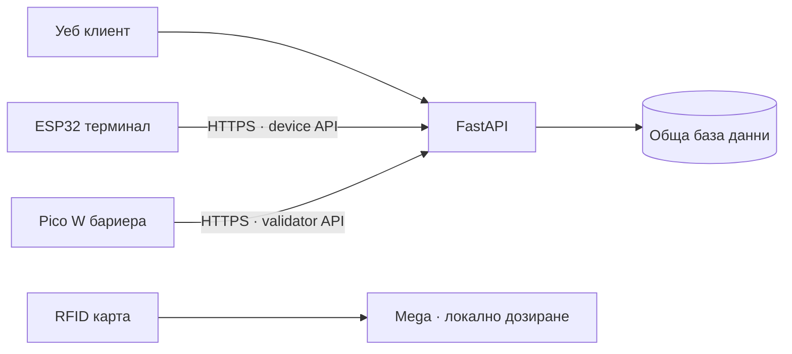

# PUKANKOV · Пуканков

**Дипломен проект за цифрово обслужване в кино:** онлайн платформа, терминал за билети, входна бариера и вендинг машина.

Автор: **Марин Тончев** · Област: уеб системи, вградени устройства и автоматизация

## Компоненти

| Компонент | Платформа | Предназначение |
| --- | --- | --- |
| [Софтуер](software/) | React · TypeScript · FastAPI · SQLAlchemy | Каталог, програма, места, поръчки, билети и администрация |
| [Билетен терминал](hardware/wokwi/ticket-kiosk/) | ESP32 · Arduino C++ | Избор на филм, прожекция и до 8 места; RFID сигнал за плащане |
| [Входна бариера](hardware/wokwi/ticket-validator/) | Raspberry Pi Pico W · MicroPython | Проверка на шестцифрен код и отваряне за 5 секунди |
| [Вендинг машина](hardware/wokwi/vending-machine/) | Arduino Mega 2560 · Arduino C++ | Пуканки, начос и четири вида напитки с локална RFID симулация |



## Основни възможности

- Каталог с 15 авторски измислени филма, програма по кина и интерактивна карта на местата.
- Задържане на места, покупка на до 8 билета, шестцифрени кодове и еднократно валидиране.
- Потребителски профили, история на поръчките, роли и административен панел.
- Общи места и поръчки за сайта и ESP32; повторение на плащане без дублиране на покупката.
- Три Wokwi проекта с код, свързване и инструкции за работа.

Плащанията са учебна симулация. Сайтът използва форма за примерна карта; ESP32 приема успешно локално RFID прочитане като сигнал за плащане, без да изпраща UID или баланс към API. Вендинг машината управлява собствен модел на наличностите в RAM.

## Стартиране

Нужни са **Python 3.11+** и **Node.js 22+**. От PowerShell:

```powershell
cd software
.\start.ps1
```

Сайт: `http://127.0.0.1:8000` · OpenAPI: `http://127.0.0.1:8000/api/docs`

За устройствата използвай [настройката на публичния API](software/docs/stable-public-api.md) и инструкциите в съответната хардуерна папка. Ключовете се създават локално за отделните роли; няма публикувани пароли, токени или база с потребителски данни.

## Структура

```text
software/                    Уеб приложение, backend, миграции и тестове
hardware/
  wokwi/vending-machine/     Mega: снаксове и напитки
  wokwi/ticket-kiosk/        ESP32: продажба на билети
  wokwi/ticket-validator/    Pico W: контрол на достъпа
  docs/                     Проверки и първоначална концепция
```

Допълнителните стенд за мотори и Linux клиент за проверка са запазени в `hardware/` като помощни разработки.

## Документация и проверка

[Софтуер и инсталация](software/README.md) · [Хардуер](hardware/README.md) · [API за устройства](software/docs/public-device-api.md) · [Архитектура](software/docs/architecture.md) · [Проверки на хардуера](hardware/docs/verification.md)

GitHub Actions проверява софтуерния build, backend и браузърните сценарии, логиката на бариерата и компилацията на вендинг контролера. Изпълнените локални проверки и ограниченията са описани в документацията. Симулираните количества и механизми изискват калибриране при физическо изграждане.
