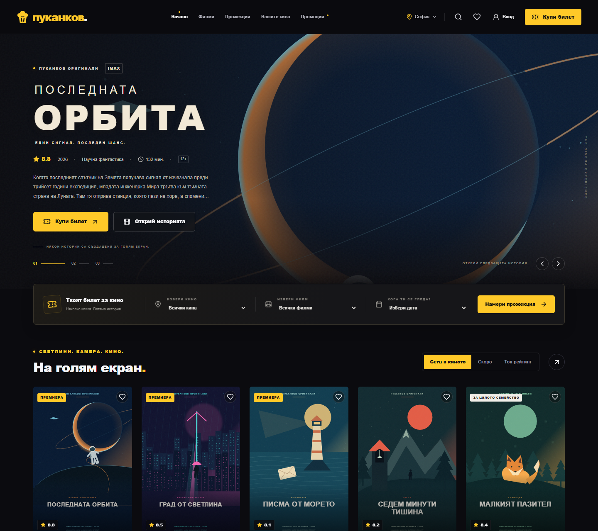
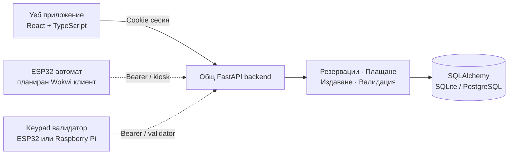

# ПУКАНКОВ · PUKANKOV

### Интегрирана система за кинобилети и автоматизирано обслужване

**Дипломен проект · Уеб технологии · Вградени системи · Транзакционни бази данни**

[](https://github.com/Di-Boss/Pukankov/actions/workflows/ci.yml)


Пуканков изследва как уеб платформа, автомат за продажба на билети и устройство за входен контрол могат да работят с обща база данни. Проектът съчетава завършен потребителски интерфейс с транзакционна логика: едно място не може да бъде продадено два пъти, а един билет не може да бъде използван повторно.

**Текущ резултат:** работещ сайт с 15 оригинални филмови концепции, учебен картов симулатор, шестцифрени билети, административен панел и API за устройства. ESP32/Wokwi симулациите и механиката за снаксове са следващи етапи; не се представят като реализиран хардуер.

[Стартиране](#бързо-стартиране) · [Архитектура](#архитектура) · [Софтуер](software/) · [Хардуер](hardware/) · [Проверки](#проверки-и-възпроизводимост)



## Изследователска цел

Да се проектира и реализира обща информационна система, която свързва онлайн покупка, продажба от терминал и еднократна проверка на билет. Основният въпрос е как да се запази съгласуваността на местата и билетите при конкурентни заявки, прекъсната връзка и повторно изпращане на операция.

Проектът използва слоеста архитектура, релационна база, миграции, отделни права за потребители и устройства и автоматизирани проверки. Академичният обхват и критериите за приемане са описани в [изискванията](software/docs/academic/requirements.md) и [методиката за оценяване](software/docs/academic/evaluation.md).

## Организация на хранилището

```text
Pukankov/
├── software/                   # Уеб приложение и общ backend
│   ├── src/                    # React / TypeScript интерфейс
│   ├── backend/
│   │   ├── app/                # API, модели и бизнес логика
│   │   ├── alembic/            # Версионирани миграции
│   │   └── tests/              # API и интеграционни тестове
│   ├── e2e/                    # Playwright браузърни сценарии
│   ├── public/images/originals/# Авторски векторни илюстрации
│   ├── docs/                   # Архитектура, API, проверка и оценяване
│   └── scripts/                # Изграждане и тестови инструменти
└── hardware/                   # Хардуерни клиенти и симулационни спецификации
    ├── wokwi/
    │   ├── ticket-kiosk/       # Подготовка за ESP32 автомат
    │   └── ticket-validator/   # Подготовка за keypad валидатор
    ├── raspberry-pi/           # Изпълним Python клиент за проверка
    └── docs/                   # Сценарии, интеграция и първоначална концепция
```

## Реализирани възможности

| Област           | Поведение                                                                     | Статус                                |
| ---------------- | ----------------------------------------------------------------------------- | ------------------------------------- |
| Филмов каталог   | 15 оригинални сюжета и SVG постери; търсене, филтри, сортиране и странициране | Реализирано                           |
| Програма и места | Кина, зали, стандартни/премиум/достъпни места и задържане за 5 минути         | Реализирано                           |
| Покупка          | Учебна картова форма, промокодове, успешна или отказана транзакция            | Реализирано                           |
| Билети           | Уникален шестцифрен код за всеки билет; профил и печат                        | Реализирано                           |
| Входен контрол   | Проверка за прожекция, зала, статус и предишна употреба в една транзакция     | Реализирано в API                     |
| Администрация    | Филми, прожекции, поръчки, статистики, роли, промокодове и одит               | Реализирано                           |
| Устройства       | Отделни ключове и роли `kiosk` / `validator`, обхват по зала и отзоваване     | Реализирано в API                     |
| ESP32 / Wokwi    | Автомат за продажба и валидатор с keypad                                      | Спецификация; предстои firmware       |
| Raspberry Pi     | Терминален клиент за проверка на код                                          | Реализиран клиент; без физически тест |
| Снакс машина     | Дозиране на пуканки, начос, сосове и напитки; следене на наличности           | Първоначална концепция                |

### Учебен платежен сценарий

Картовата форма изглежда като обичайна покупка, но приема **само измислени данни**. Номерът, името, валидността и CVV остават в паметта на браузъра. API получава идентификатор на задържането, промокод, съгласие и избрания резултат на симулацията.

- Отметнато **„Успешна транзакция“** → потвърдена поръчка и шестцифрени билети.
- Без отметка → отказ, без издадени билети и с освободени места.
- Повторен checkout за същото задържане → същата поръчка, без дублиране.

Не се прехвърлят реални средства. Кината, програмата и рейтингите са примерни.

## Архитектура



Плътната връзка представя работещия уеб поток; прекъснатите връзки показват подготвената интеграция с физически устройства. API договорът е реализиран и проверен независимо от бъдещия firmware.

Данните се управляват единствено от backend. Уникално ограничение за място/прожекция предотвратява двойно заемане. Уникален код и транзакционно маркиране предотвратяват повторното използване на билет. SQLite сериализира транзакциите с `BEGIN IMMEDIATE`; PostgreSQL използва редови блокировки. PostgreSQL конкурентността остава за отделна проверка.

Подробности: [софтуерна архитектура](software/docs/architecture.md), [API](software/docs/api.md), [договор за устройствата](software/docs/devices.md).

## Бързо стартиране

**Изисквания:** Node.js 22+, Python 3.11+ и Git. Проверената локална среда е Windows, Node.js 24, Python 3.13 и Chromium.

```powershell
git clone https://github.com/Di-Boss/Pukankov.git
cd Pukankov/software
.\start.ps1
```

Скриптът инсталира зависимостите, изгражда интерфейса, прилага миграциите, създава примерния каталог и пуска [http://127.0.0.1:8000](http://127.0.0.1:8000). Остави терминала отворен. За следващи стартирания след първоначалната подготовка може да използваш `software/START-SITE.cmd`.

Ако PowerShell не разрешава изпълнение на скриптове, използвай [ръчните команди](software/README.md#разработка-два-терминала). Linux/macOS и Docker инструкциите също са в [софтуерното ръководство](software/README.md). Пароли, ключове и локални бази не са включени в Git.

### Администратор

В отделен терминал:

```powershell
cd Pukankov/software/backend
python -m app.cli create-admin --email you@example.com --name "Твоето име"
```

Паролата се въвежда интерактивно. След вход отвори `/admin`. Няма фиксиран публичен администраторски акаунт.

### Ключ за устройство

От `software/backend/`:

```powershell
python -m app.device_cli create --name "Вход зала 1" --role validator --auditorium-id 1
```

Ключът се показва само веднъж. Пълният поток за терминал и валидатор е описан в [хардуерната част](hardware/README.md).

## Проверки и възпроизводимост

| Проверка                          | Последен локален резултат           |
| --------------------------------- | ----------------------------------- |
| TypeScript и production build     | Успешни                             |
| Backend / интеграционни тестове   | 37 преминали                        |
| Браузърни сценарии                | 15 преминали                        |
| Миграции и съответствие на модели | Проверени върху SQLite              |
| Адаптивен интерфейс               | 360, 390, 768, 1024, 1440 и 1920 px |
| PostgreSQL / физически хардуер    | Не са проверени в тази версия       |

Резултатите са от 27 октомври 2026 г. Новата структура е проверена след `npm ci`, с браузърни заявки през реални локални HTTP сървъри и отделна тестова база. GitHub Actions повтаря проверките върху чисто копие. Подробните условия и ограничения са в [протокола](software/docs/verification.md).

От `software/`:

```powershell
npm ci
npm run build
python -m pip install -r backend/requirements.txt
python -m pytest backend/tests -q
npx playwright install chromium
npm run test:e2e
```

Покрити са конкурентно резервиране, отказана транзакция, повторен checkout, колизия на кодове, два едновременни валидатора, грешна прожекция, отзован ключ и миграция на стар билет. Браузърните тестове проверяват и че картовите полета не попадат в API заявката.

## Документация

| Документ                                                            | Съдържание                                         |
| ------------------------------------------------------------------- | -------------------------------------------------- |
| [Софтуерно ръководство](software/README.md)                         | Стартиране, настройки, роли и ограничения          |
| [Изисквания и проследимост](software/docs/academic/requirements.md) | Цели, критерии и връзка с реализацията             |
| [Методика за оценяване](software/docs/academic/evaluation.md)       | Хипотези, експерименти и граници на резултатите    |
| [Архитектура](software/docs/architecture.md)                        | Слоеве, транзакции, време и достъп                 |
| [API](software/docs/api.md)                                         | Публични, потребителски и административни маршрути |
| [Устройства](software/docs/devices.md)                              | Продажба от автомат и проверка на код              |
| [Хардуерни сценарии](hardware/docs/validation-scenarios.md)         | План за Wokwi и физически изпитвания               |
| [Проверки](software/docs/verification.md)                           | Реални резултати и условия на изпълнение           |
| [Оригинално съдържание](software/docs/asset-credits.md)             | Произход и възпроизвеждане на илюстрациите         |
| [Внедряване](software/docs/deployment.md)                           | Docker, PostgreSQL и конфигурация                  |

## Следващи етапи

1. ESP32 firmware, keypad и дисплей във Wokwi с отделни ключове за всяко устройство.
2. Проверка на общия поток: сайт → покупка → код → еднократно допускане.
3. Хардуерно изпитване на Raspberry Pi и проверка при прекъсната връзка.
4. Прототип на дозиращата машина за снаксове по [първоначалната концепция](hardware/docs/original-concept.md).
5. Отделни изпитвания на PostgreSQL, натоварване и разпределен rate limiter.

Поддръжка: [Di-Boss](https://github.com/Di-Boss). За промени виж [указанията за принос](CONTRIBUTING.md).
