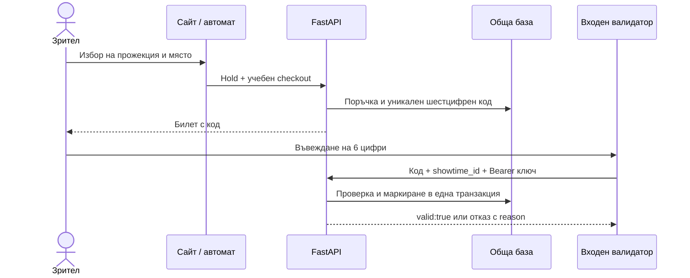

# Хардуер и симулации

Хардуерната част на Пуканков свързва физическото обслужване с общия backend в [`software/`](../software/). Тази папка съдържа работещ терминален Python клиент и спецификации за бъдещите ESP32/Wokwi прототипи. Firmware, електрически схеми, GPIO управление и реални симулационни резултати още не са добавени.

## Модули

| Модул                                                | Предназначение                                              | Текущо съдържание                                        |
| ---------------------------------------------------- | ----------------------------------------------------------- | -------------------------------------------------------- |
| [`wokwi/ticket-kiosk/`](wokwi/ticket-kiosk/)         | Избор на прожекция/място, учебна покупка и показване на код | Спецификация и критерии за приемане                      |
| [`wokwi/ticket-validator/`](wokwi/ticket-validator/) | Въвеждане на код чрез keypad и еднократен вход              | Спецификация и състояния на интерфейса                   |
| [`raspberry-pi/`](raspberry-pi/)                     | Клиент за проверка на билет                                 | Изпълним Python скрипт без външни зависимости            |
| [`docs/`](docs/)                                     | Планиране и оценяване                                       | Сценарии за проверка и първоначална идея за снакс машина |

## Интеграционен принцип

Нито сайтът, нито Pi изпращат билети директно към ESP32. Наличността и валидността се определят от сървъра. При липса на положителен отговор валидаторът отказва вход.

## Подготовка

1. Стартирай сайта по [софтуерното ръководство](../software/README.md).
2. Създай отделен ключ за всяко устройство с `python -m app.device_cli create` от `software/backend/`.
3. Използвай `kiosk` за продажба и `validator` за проверка. По желание ограничи устройството до конкретна зала.
4. Задай достъпен адрес на API; `127.0.0.1` на физически Pi означава самото Pi.
5. Въведи `showtime_id` от програмата. Кодът без прожекция не е достатъчен за проверка.

Полета, endpoints, отговори, лимити и Wokwi мрежа: [общ API договор](../software/docs/devices.md).

## План за експерименти

Провери последователно положителен вход, повторен код, грешна прожекция, изтекъл билет, липса на мрежа и два едновременни валидатора. За всеки експеримент запиши версията на софтуера, схемата, входните данни и действителния резултат по [матрицата на сценариите](docs/validation-scenarios.md).

Първоначалната идея за пуканки, начос и напитки е запазена в [original-concept.md](docs/original-concept.md). Механиката, дозиране, сензори и работа с продукти са отделен бъдещ етап.
